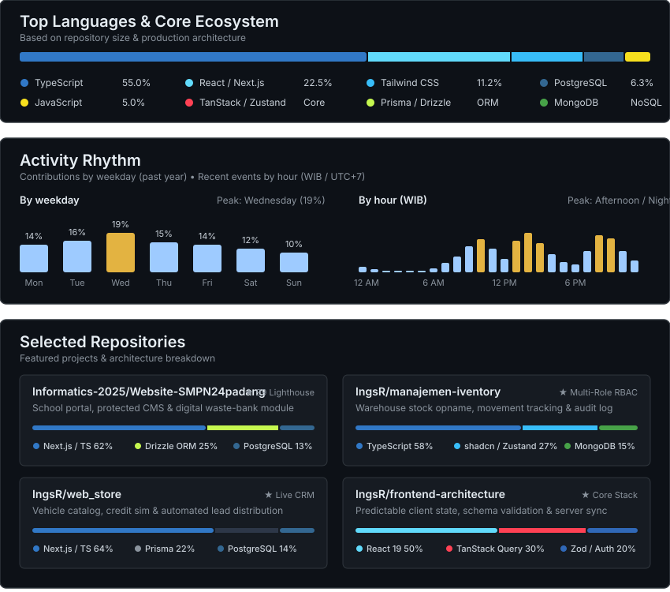

  

  

# Ikhwan Ramadhan

Frontend engineer with a focus on React and TypeScript, developing a working understanding of how component architecture, state management, and server interactions shape the overall quality of web applications.

My work tends to gravitate toward the boundary between interface design and application logic how data flows through components, where state should be owned, and how to keep client-side behavior predictable as an application grows in scope. A working knowledge of backend systems, databases, authentication, and deployment informs these frontend decisions rather than competing with them.

---

### Engineering Focus

**Primary:** React · Next.js (App Router) · TypeScript  
**State & Server Data:** TanStack Query · Zustand · Zod · Fetch API  
**UI:** Tailwind CSS · shadcn/ui · Framer Motion

**Supporting foundation:** PostgreSQL · Prisma · Drizzle ORM · Auth.js

---

## Selected Projects

### 1. SMP Negeri 24 Padang | School Information Portal, CMS & Digital Waste Bank

_Internship placement · August–September 2025 · Five-person team_  
**Role:** Team Lead & Full-Stack Web Developer  
**Links:** [smpn24padang.sch.id](https://smpn24padang.sch.id) · [Repository](https://github.com/Informatics-2025/Website-SMPN24padang)

**Stack:** Next.js App Router · React · TypeScript · Tailwind CSS · Drizzle ORM · PostgreSQL · Auth.js

The school required more than a static information page. Staff needed to update content independently, and the school's waste-bank program required a dedicated digital module with its own data and reporting workflows. Working in a five-person team, I led the technical design and coordinated delivery while remaining directly involved in implementation.

The architecture separates the public-facing portal from the protected CMS, with Auth.js handling authentication and route-level access control. The waste-bank module manages automated balance calculations and PDF report generation. The site scored **99/100 on Lighthouse Performance** and is deployed to the school's official domain, actively used by staff.

---

### 2. Inventory Management System

**Stack:** Next.js App Router · TypeScript · Tailwind CSS · shadcn/ui · MongoDB  
**Repository:** [IngsR/manajemen-iventory](https://github.com/IngsR/manajemen-iventory)

This project addresses the operational complexity of warehouse inventory management — a domain that extends well beyond a basic CRUD interface. The application handles receiving, issuing, returning, transferring, and adjusting stock, alongside stock opname workflows, balance tracking, movement history, and an audit log.

The application is structured around distinct workspaces for administrators, supervisors, and inventory officers. Reusable UI components are built from shadcn/ui, and a dashboard-level store manages shared view state. Domain logic, application actions, and data models are separated by responsibility. The goal was an interface where each role operates within a coherent, purpose-appropriate workspace backed by consistent data integrity.

---

### 3. Automotive Sales Management Platform

**Stack:** Next.js · TypeScript · Prisma · PostgreSQL  
**Links:** [cars.ikhwann.my.id](https://cars.ikhwann.my.id) · [Repository](https://github.com/IngsR/web_store)

A platform that combines a public vehicle catalog with internal sales workflows: customer booking, sales tracking, and credit simulation. The lead assignment system is the most structurally interesting part — when an administrative user verifies a prospective buyer, the system automatically assigns the lead to an active sales consultant based on the lowest current quota and oldest prior assignment, distributing workload evenly across the team and generating a formatted message ready for WhatsApp handoff.

This required thinking carefully about the relationship between UI state, workflow triggers, and the underlying business logic — the interface needed to reflect assignment outcomes accurately and remain consistent with what the backend had recorded.

---

## Professional Direction

As a recent computer science graduate, I am looking for a **Junior Frontend Engineer** or **React Developer** role where I can contribute to product development while continuing to deepen my understanding of frontend engineering. I am most interested in environments where the quality of the interface and the integrity of the underlying data model are both taken seriously.

 

  
  

---

**Technology Stack**

**Primary**  

**State & Server Data**  

**Supporting Foundation**  

