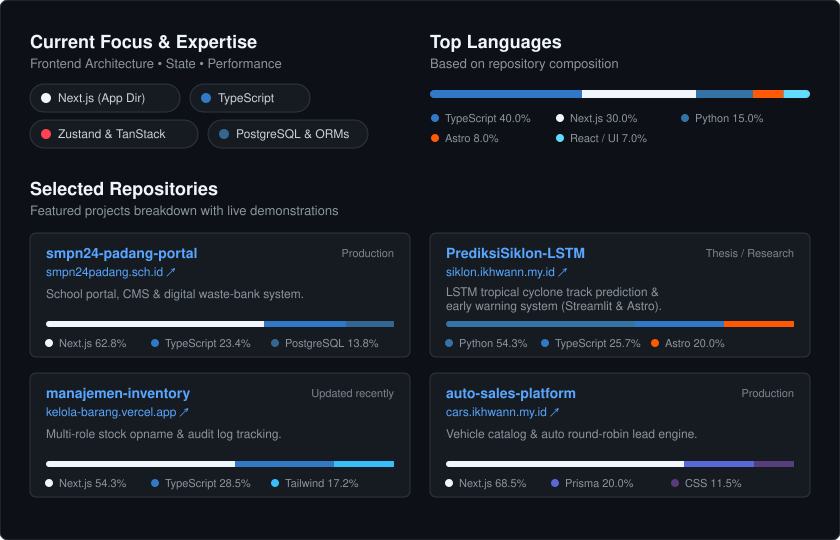

# `const developer = "Ikhwan Ramadhan";` 👋

I go by **Ikhwan**, a **Frontend Engineer** whose work sits at the convergence of interface design, component architecture, and application logic. My primary focus is building predictable, high-performance web applications with **React, Next.js, and TypeScript**, where client-side state management, schema validation, and server data synchronization are treated as first-class concerns. A working knowledge of backend systems including PostgreSQL, Prisma, Drizzle, and Auth.js further grounds that focus, ensuring UI responsiveness and data integrity reinforce rather than compromise each other.

Currently considering **Junior Frontend Engineer** or **React Developer** opportunities. Live deployments and featured repositories are listed below.

- 🌐 **Live Deployments:** [SMPN 24 Padang Portal](https://smpn24padang.sch.id) · [Automotive Sales Platform](https://cars.ikhwann.my.id)
- 📦 **Featured Codebases:** [Website-SMPN24padang](https://github.com/Informatics-2025/Website-SMPN24padang) · [manajemen-iventory](https://github.com/IngsR/manajemen-iventory) · [web_store](https://github.com/IngsR/web_store)

  

For a more complete picture of my work, case studies, and contact details, visit **[ikhwann.my.id](https://ikhwann.my.id)**.
